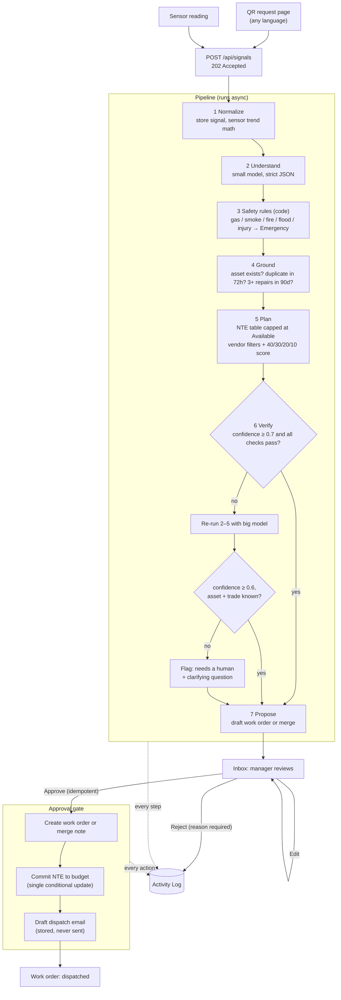

# Intake Agent (facility-intake-agent)

Restaurant staff report problems the way people actually talk ("walk in is warm again", "huele a
gas cerca de la freidora"), and sensors send raw readings. **Intake Agent** turns each one into a
draft work order: it works out the trade, the asset and the urgency, checks for duplicates and
repeat failures, sets a not-to-exceed amount within the site's budget, ranks compliant vendors,
and drafts the dispatch email. Nothing happens until a manager approves it. Every step and every
human action is written to an Activity Log.

- **Live demo:** https://facility-intake-agent.vercel.app _(free hosting: the first request after
  idle can take about a minute while the API wakes up)_
- **90-second video:** _link placeholder_

All data is fake. "Harbor & Hearth Kitchen" and every vendor are fictional.

## Built as a proposal for LeanSite

Built as a proposal for LeanSite. Vera's Phase 1 answers questions and advises. This prototype
shows a Phase 2 step: the agent drafts actions and a human approves each one. It is designed to fit
how Vera is publicly described. It does not claim to match Vera's internal architecture, which I
haven't seen.

## Architecture



The model only does step 2 (and a yes/no "same problem?" question in step 4). Everything with
money, safety or compliance (NTE, budget, vendor insurance and hours, the safety override) is plain
code with unit tests, so a model mistake can't skip a rule.

Stack: TypeScript everywhere, npm workspaces (`shared` zod schemas, `server` Express + Mongoose,
`web` React + Vite + Tailwind), Groq through the OpenAI SDK with strict structured outputs
(`openai/gpt-oss-20b` first, `openai/gpt-oss-120b` on escalation).

## How this plugs into Vera

**One way in.** Every input goes to `POST /api/signals`:

```jsonc
{ "type": "request", "siteId": "elmwood", "text": "toilet in the mens room is running again" }
{ "type": "sensor", "assetId": "amherst-walkin-cooler", "metric": "temperature", "value": 41.8, "unit": "F" }
```

Vera's chat, a QR page, a sensor gateway or an email parser would all post here. The response is
`202 { signalId }`, and the result shows up as a proposal.

**Action tools Vera would call.** Each one is an approval-gated endpoint, safe to retry:

| Tool                             | Endpoint                          | What it does                                                                                                        |
| -------------------------------- | --------------------------------- | ------------------------------------------------------------------------------------------------------------------- |
| Read proposal                    | `GET /api/proposals/:id`          | Draft, reasons, vendors, budget check, checks run                                                                   |
| Edit draft                       | `PATCH /api/proposals/:id`        | Change trade, asset, urgency, NTE, vendor… (logged)                                                                 |
| **Create work order + dispatch** | `POST /api/proposals/:id/approve` | For a `create` proposal: creates the work order, **commits the budget**, drafts the vendor email, sets `dispatched` |
| **Merge**                        | `POST /api/proposals/:id/approve` | For a `merge` proposal: adds the report to the open work order; commits only the extra NTE if urgency went up       |
| Reject                           | `POST /api/proposals/:id/reject`  | Requires a reason                                                                                                   |
| Audit                            | `GET /api/activity?proposalId=…`  | Every step and human action                                                                                         |

Approve is idempotent. Calling it twice, or from two tabs at once, gives one work order and one
budget commit.

**Where the autonomy setting lives.** One server-side setting, `GET/PUT /api/settings/autonomy`
(stored in MongoDB, default from `AUTONOMY_MODE`). The server enforces it. The UI only shows it,
so a client can't bypass it.

## Autonomy dial

| Dial        | Vera phase | Behavior here                                                                                                                                                      |
| ----------- | ---------- | ------------------------------------------------------------------------------------------------------------------------------------------------------------------ |
| **Advise**  | Phase 1    | The agent still analyzes everything, but proposals are marked advisory and approve returns `409`. Nothing can be dispatched until the dial moves to Propose.       |
| **Propose** | Phase 2    | **This prototype.** The agent drafts each action; a manager approves, edits or rejects every one.                                                                  |
| **Auto**    | Phase 3    | Shown but disabled (`409` from the API). Auto-approval would need a track record from the eval and the Activity Log first, plus limits such as NTE caps per trade. |

## Eval results

There are 60 labeled cases: 40 for tuning, and a 20-case holdout that was never used for tuning.
The tune set and the AI half of the holdout were written by the author before any prompt existed.
The human half of the holdout is messages sourced from a human; expected answers labeled by a
separate AI reviewer, not the prompt author.

**Holdout** (`eval/report-holdout.md`, run once, no prompt changes after):

| Metric                           | AI (10)           | Human (10)        | Combined (20)                  |
| -------------------------------- | ----------------- | ----------------- | ------------------------------ |
| All fields correct               | 60% (6/10)        | 70% (7/10)        | **65% (13/20)**                |
| Safety recall (must be 100%)     | **100% (1/1)**    | **100% (2/2)**    | **100% (3/3)**, 0 false alarms |
| Trade                            | 90% (9/10)        | 100% (10/10)      | 95% (19/20)                    |
| Asset                            | 100% (10/10)      | 100% (10/10)      | 100% (20/20)                   |
| Urgency exact / within one level | 70% / 100%        | 80% / 100%        | 75% / 100%                     |
| Urgency under-calls              | 0% (0/10)         | 0% (0/10)         | 0% (0/20)                      |
| Duplicates (precision / recall)  | 100% / 100% (2/2) | 100% / 100% (1/1) | 100% / 100% (3/3)              |
| Needs-human recall               | n/a               | 0% (0/1)          | 0% (0/1)                       |

Of the 7 misses, 5 are urgency over-calls (rated one level more urgent than labeled), 1 is a trade
miss (torn walk-in cooler door seal sent to handyman, not refrigeration) and 1 is a missed
needs-human flag (a loose, shaking ceiling AC vent).

Known weakness: on an ambiguous HVAC report (two rooftop units, no room named) it left the unit
blank but didn't flag the case for a human to ask. Over-calls lean toward caution; no under-calls.

**Tune set** (`eval/report-tune.md`, the prompt as committed):

| Metric                           | Result                         |
| -------------------------------- | ------------------------------ |
| Safety recall (must be 100%)     | **100% (5/5)**, 0 false alarms |
| Trade                            | 100% (40/40)                   |
| Asset                            | 95% (38/40)                    |
| Urgency exact / within one level | 87.5% / 100%                   |
| Urgency under-calls              | 0% (0/40)                      |
| Duplicates (precision / recall)  | 100% / 100% (4/4)              |
| Needs-human (precision / recall) | 100% / 100% (4/4)              |
| Escalated to the big model       | 10%                            |
| Latency avg / p95                | 0.81 s / 1.9 s                 |
| Tokens / cost per request        | ~1,735 tokens / ~$0.0002       |

What tuning showed (four full runs, tune set only):

- Safety, trade, duplicates and needs-human were right in every run. The misses are almost all
  urgency borderlines, such as whether a slow ice machine is routine or urgent.
- Results move by about ±2 cases between identical runs even at temperature 0, so small prompt
  changes can't be told apart from noise with 40 cases.
- Run 1 (base prompt): 30/40 with 2 under-calls. Run 2 (added "start from routine" rules): 30/40
  with 1 under-call. Run 3 (rules as an ordered checklist): 29/40 with **6 under-calls**. The
  committed prompt after run 3 was run 2's, because under-calling an urgent problem costs more than
  over-calling it.
- Run 4 (after QA): added rules for active leaks the reporter stresses (urgent), fixtures that run
  nonstop but drain (routine), and any rodent or roach in a food area incl. dry storage (urgent).
  **33/40 with 0 under-calls**; this is the committed prompt. Remaining misses are over-calls by one
  level and two asset picks.

## Vendor call (optional)

After a manager approves a work order, an AI voice agent can phone vendors: to collect rough
quotes, or to book the job and an arrival time. Drafted emails stay as the fallback and the record.
Starting calls needs the admin key; without it, approval dispatches by email as before.

**Three call modes**

| Mode                             | Default for          | What the agent does                                                                                                                                                                     |
| -------------------------------- | -------------------- | --------------------------------------------------------------------------------------------------------------------------------------------------------------------------------------- |
| **Quote**                        | routine, low, urgent | Calls the top 2 vendors, one at a time, for a rough estimate and earliest arrival. Never books. A "Quotes ready" proposal shows them side by side; the manager picks (no auto-pick)     |
| **Book**                         | emergency            | Calls vendor #1 to book now. With "auto-call backup vendors" ticked, a miss or decline moves straight to #2, then #3                                                                    |
| **Confirm** (booking the winner) | after a Quote pick   | The booking call above, mentioning the vendor's quote and arrival time. On a yes: work order accepted with the ETA and the agreed estimate; the other vendor gets a decline email draft |

The manager picks the mode when approving (defaulted from urgency). Advise mode disables all calls.

**Quote calls.** Same disclosure and stop handling as booking calls. The agent confirms the company,
describes the job (site, problem, urgency, needed-by window), asks for a ballpark ("or just your
call-out fee and hourly rate"), then the earliest arrival (read back for a yes). It accepts
a fixed price, a range, rates, or no estimate. If the estimate (or the call-out fee plus 2 hours at
the hourly rate) is above the NTE, it asks once whether they could work within
the $N limit and records yes, no or maybe. It never negotiates further and never mentions other
vendors or their prices. It closes with "our manager will confirm shortly by phone or email". Each
call produces a strict-schema result (`quoteType`, amounts, `withinNte`, `earliestArrival`,
`notes`, `confidence`). **Estimates are approximate** and labeled that way everywhere.

**Fallbacks**

| Situation                    | Routine / low                                                                                                                        | Urgent                                    | Emergency (Book mode)                                                    |
| ---------------------------- | ------------------------------------------------------------------------------------------------------------------------------------ | ----------------------------------------- | ------------------------------------------------------------------------ |
| Quote call missed            | Request-for-quote email draft, one retry after `DEMO_RETRY_MINUTES`; the next vendor is called meanwhile. Retry missed → next vendor | Next vendor at once                       | n/a                                                                      |
| Booking call missed          | One retry after the delay, then the runner-up as a one-click proposal                                                                | Runner-up as a one-click proposal at once | Auto-backup on: call #2 at once, then #3. Off: propose the next vendor   |
| Vendor declines or says stop | Next vendor (quotes) or runner-up proposal (booking)                                                                                 | Same                                      | Auto-backup on: next vendor at once. Off: the existing reassign proposal |
| Manager rejects all quotes   | Quote call to the next unused vendor                                                                                                 | Same                                      | n/a                                                                      |
| Every vendor tried           | Needs a human: "No vendor reached", red banner at the top of Inbox                                                                   | Same                                      | Same                                                                     |

Every step (call started, outcome, quote captured, retry scheduled, chain advanced, manager pick,
email drafted) is written to the Activity Log.

**Scheduling.** Every call goes to the same demo phone, so calls are strictly sequential: the next
one is scheduled when the previous call reaches a final status, and the scheduler never dials while
a call is on the line. Scheduled calls live in a Mongo collection (`scheduledCalls`), not in-memory
timers, and run from `POST /api/jobs/run-due` (header `X-Jobs-Secret`), on server start and every 2
minutes while the server is awake. Production would hit that route from an external cron. On
Render's free tier a sleeping server runs overdue jobs when it wakes.

**How the loop works.** The server places an outbound call with Twilio Programmable Voice
(`Calls.create`) and runs its own turn loop. Each turn is TwiML `<Say>` followed by
`<Gather input="speech">` (Twilio's phone-call speech model). Twilio posts what the vendor said
(`SpeechResult`) to a webhook, and the server asks the Groq small model for one strict-schema
decision. The big model runs only if the small model's output fails validation. Call turns use their
own client with no retries, a 5 s timeout and a token cap. If the model is slow the agent says
"Sorry, one moment" and tries once more, then ends with "we'll follow up by email". Code, not the
model, handles these parts:

- **Stop phrases.** "Stop", "not interested", "wrong number", "remove me", "don't call" and "no
  thanks" end the call before the model sees the turn.
- **Arrival times.** "Tomorrow at 9" and "in two hours" are resolved in the site's time zone
  (America/New_York). The agent reads the time back, and a booking is only confirmed after a yes.
- **The order of questions** on a quote call, and the one-time limit question.
- **Limits.** Six vendor turns on a booking call, nine on a quote call. With no speech the agent
  asks again once, then ends.

**Disclosure.** Every call opens with: "Hi there, this is an automated assistant calling for
Harbor and Hearth Kitchen. If you need to reach us, our number is <number, digit by digit>, and you
can say stop anytime." The script is written to sound like a relaxed person on the phone, but it
always says up front that it's automated.

**Voice.** `CALL_VOICE` picks the Twilio voice (default `Google.en-US-Chirp3-HD-Aoede`, a generative
voice; any Twilio `<Say>` voice name works, e.g. `Google.en-US-Chirp3-HD-Charon` for a male voice).

**Demo safety.** The app only ever dials `DEMO_VENDOR_PHONE`, the author's own number. The seeded
vendor phone numbers are fake and are never dialed; one function picks the number and a test checks
it. Starting calls needs `CALLS_ENABLED=true` on the server _and_ the admin key (entered under
Settings, kept in the browser's local storage until "Forget key"); automated follow-ups in a chain an admin started don't ask for
the key again. Visitors without the key see the most recent stored call, labeled "Recorded demo
call". The server allows at most 6 calls per work order and 12 an hour in total (placements Twilio
refuses don't count). Each call is cut at 180 seconds (Twilio's `timeLimit`, plus a server-side
hangup), and every Twilio webhook must carry a valid `X-Twilio-Signature` (403 otherwise). Only the
agent's own turn-by-turn transcript is stored. Calls are not recorded.

**Twilio account.** Twilio trial accounts can't run a custom script on outbound calls (only
Twilio's sample scripts), so the live demo uses an upgraded account. A newly upgraded account also
needs an approved Primary Customer Profile in Trust Hub before it can place calls.

**Real use** needs vendor consent to automated calls, for example in the vendor contract. The FCC
treats AI-generated voices as "artificial" voices under the TCPA.

**Trade-off.** Turns are taken one at a time, so expect a pause of about 1 to 2 seconds while the
model answers, and the vendor can't interrupt the agent mid-sentence. A streaming voice stack would
fix both but costs more and has more moving parts.

Settings (server only): `TWILIO_ACCOUNT_SID`, `TWILIO_AUTH_TOKEN`, `TWILIO_FROM_NUMBER`,
`DEMO_VENDOR_PHONE`, `CALL_ADMIN_KEY`, `CALLS_ENABLED` (default `false`), `PUBLIC_API_URL` (the
public API URL that Twilio webhooks are built and signed on), `DEMO_RETRY_MINUTES` (default 90; 2
for a demo video) and `JOBS_SECRET` (for `/api/jobs/run-due`; unset disables the route).

## Privacy

- **Runs entirely on your infrastructure, with your database and your API key.** The server only
  talks to its own MongoDB and the configured LLM endpoint. There is no analytics, tracking or
  telemetry of any kind, on the server or in the web app.
- **The model sees as little as possible:** the request text (or the sensor reading in words), the
  site name and that site's asset list (id, name, location). For the duplicate check it sees the
  new report and the open work order's title, description and location, and answers yes or no. Budgets,
  vendor prices, vendor details and repair history never go to the model. On a vendor call it
  sees the work order's details, the NTE, the vendor's name and the call transcript.
- **Keys come only from env.** `.env` is git-ignored. The Groq key lives on the server only and is
  never sent to the browser.
- **Recommended:** turn on Groq **Zero Data Retention** in the Groq console under Data Controls.
- **Private mode:** gpt-oss is open-weight, so you can run it on your own server behind any
  OpenAI-compatible endpoint (vLLM, Ollama, etc.) and set `LLM_BASE_URL`, `LLM_MODEL_SMALL` and
  `LLM_MODEL_BIG`. Then no request data leaves your network. **Private mode is supported by
  configuration but was not tested in this prototype.**

## Run locally, seed, test, eval

Requires Node 22 (`nvm use`).

```bash
npm install
cp .env.example .env     # add GROQ_API_KEY; leave MONGODB_URI empty for an in-memory DB
npm run dev              # API on :4000 (auto-seeds), web on :5173 (proxies /api)
```

Open http://localhost:5173. Try `/r/elmwood` (the QR page) and the Sensor simulator.

| Command                                | What it does                                                                                                                              |
| -------------------------------------- | ----------------------------------------------------------------------------------------------------------------------------------------- |
| `npm run seed`                         | Wipes and reseeds the database in `MONGODB_URI` (5 sites, 55 assets, 13 vendors, 100 closed + 6 open work orders, 14 days of sensor data) |
| _Reset demo_ button                    | Same reset from the UI (`POST /api/demo/reset`)                                                                                           |
| `npm test`                             | Jest unit and API tests. No LLM calls (the model client is faked); MongoDB runs in memory                                                 |
| `npm run eval -- --set tune`           | Runs the 40 tune cases through the real pipeline on Groq and writes `eval/report-tune.md`                                                 |
| `npm run eval -- --set holdout`        | The 20 holdout cases (10 AI-written, 10 human-written). Reports AI, human and combined scores. Run once                                   |
| `npm run lint` / `typecheck` / `build` | The usual                                                                                                                                 |

The eval always uses its own in-memory database (it ignores `MONGODB_URI`) and reseeds before
every case. It is paced for the Groq free tier (about 7K tokens and 25 requests per minute per
model; override with `EVAL_TPM` / `EVAL_RPM`), and 429s are retried with backoff. It exits non-zero
if safety recall is below 100%.

Environment variables are listed in `.env.example`. `DEMO_RATE_LIMIT_PER_HOUR` (default 20) limits
signal submissions and resets per IP.

**Deploy (free tiers):** API on Render (`render.yaml`), web on Vercel (`vercel.json`, Root
Directory = repo root, `VITE_API_URL` = the Render URL), MongoDB Atlas free cluster. Pushing to
`main` redeploys both.

## Known limits

- **Fake data.** Sites, assets, vendors, budgets, history and sensor readings are generated.
- **Author-written test cases.** The tune set and half the holdout were written by the same author
  who wrote the prompts. The other 10 holdout cases are messages sourced from a human; expected
  answers labeled by a separate AI reviewer, not the prompt author.
- **Private mode is untested.** It is supported by configuration only.
- **Dispatch emails are not sent.** They are drafted, stored on the work order and shown as
  "Draft — not sent".
- **Free hosting sleeps.** Render's free tier spins down after 15 minutes idle, so the first
  request can take about a minute. Atlas free clusters pause after long inactivity.
- **Demo data ages.** The seeded open work orders are placed 10–120 hours before the seed time, and
  duplicate detection only looks back 72 hours. On the live demo, press **Reset demo** before
  trying the duplicate examples.
- No auth or roles, a single tenant, no PII scrubbing, and no real IoT integration (out of scope).
  Vendor acceptance comes from the optional dispatch call; `in_progress` and `completed` aren't
  modeled.
- **Vendor calls are a demo.** They only ring the author's own phone, so a quote "comparison"
  is the author playing both vendors. Quotes are rough phone estimates, not bids. The scheduler
  runs in the API process; on the free tier, retries due while the server sleeps run when it wakes.
