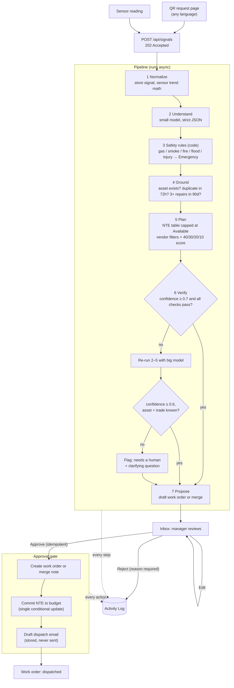

# Intake Agent (facility-intake-agent)

**Overview** · [Design](docs/design.md) · [Vendor calls](docs/vendor-calls.md) · [Eval](docs/eval.md) · [Setup](docs/setup.md)

Restaurant staff report problems the way people actually talk ("walk in is warm again", "huele a
gas cerca de la freidora"), and sensors send raw readings. **Intake Agent** turns each one into a
draft work order: it works out the trade, the asset and the urgency, checks for duplicates and
repeat failures, sets a not-to-exceed amount within the site's budget, ranks compliant vendors,
and drafts the dispatch email. Nothing happens until a manager approves it. Every step and every
human action is written to an Activity Log.

- **Live demo:** https://facility-intake-agent.vercel.app _(free hosting: the first request after
  idle can take about a minute while the API wakes up)_
- **API health:** https://facility-intake-agent-api.onrender.com/api/health

All data is fake. "Harbor & Hearth Kitchen" and every vendor are fictional.

## Built as a proposal for LeanSite

Vera's Phase 1 answers questions and advises. This prototype shows a Phase 2 step: the agent
drafts actions and a human approves each one. It is designed to fit how Vera is publicly described.
It does not claim to match Vera's internal architecture, which I haven't seen.

## Architecture



The model only does step 2 (and a yes/no "same problem?" question in step 4). Everything with
money, safety or compliance (NTE, budget, vendor insurance and hours, the safety override) is plain
code with unit tests, so a model mistake can't skip a rule.

Stack: TypeScript everywhere, npm workspaces (`shared` zod schemas, `server` Express + Mongoose,
`web` React + Vite + Tailwind), Groq through the OpenAI SDK with strict structured outputs
(`openai/gpt-oss-20b` first, `openai/gpt-oss-120b` on escalation).

## Results at a glance

- **Safety recall 100%** on every eval run: gas, smoke, fire, flood and injury reports are always
  flagged Emergency, with 0 false alarms.
- **Holdout (20 unseen cases): 65% all fields correct**, 95% trade, 100% asset, 0 urgency
  under-calls: when urgency is wrong, it is rated more urgent, never less. [Full eval →](docs/eval.md)
- **Approve is idempotent and budget-safe:** one work order and one budget commit, even from two
  tabs at once. [Design →](docs/design.md)
- **Optional vendor phone calls:** an AI voice agent collects quotes or books the job, with
  fallbacks, rate limits and a stop-phrase kill switch. [Vendor calls →](docs/vendor-calls.md)

## Quick start

Requires Node 22 (`nvm use`).

```bash
npm install
cp .env.example .env     # add GROQ_API_KEY; leave MONGODB_URI empty for an in-memory DB
npm run dev              # API on :4000 (auto-seeds), web on :5173 (proxies /api)
```

Open http://localhost:5173. Try `/r/elmwood` (the QR page) and the Sensor simulator. Tests, eval,
env vars and deploy: [Setup →](docs/setup.md)

## What's next

- **Staff follow-up questions at intake.** One or two tap-to-answer questions per trade (e.g.
  "Is water on the floor?", "Is it one sink or several?"), so vendor calls carry richer details and
  the agent says "I don't have that detail" less often.
- **Photos on requests.** Attach a photo at intake, shown to the manager and described to vendors.
- **Auto mode (Phase 3)** for low-risk routine jobs: the agent approves and books within tight
  limits instead of proposing.
- **Production calling.** A purchased phone number and vendor consent to automated calls, instead
  of the demo number that only rings the author's phone.
